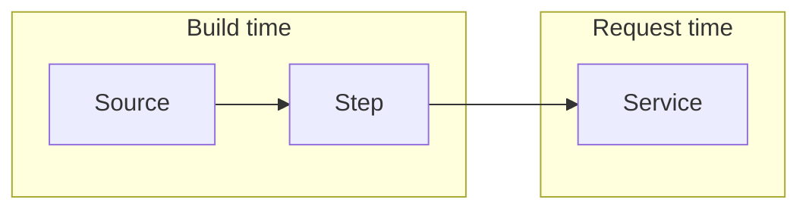

# ADR-NNN: <decision, as a sentence>

- **Status:** Proposed | Accepted | Superseded by ADR-NNN
- **Date:** YYYY-MM-DD
- **Numbers:** which report or config the numbers in this ADR come from

## 1. Context

The product ask (users, surface, scale, latency budget, how often the data changes), then the few facts that drive the design: what can be precomputed, what the AI steps cost and how they fail, and what's regulated or risky.

## 2. Decision

What runs where (build time vs request time), with the real numbers for every rule. How the evaluation gates release, and what the serving side checks before serving (attestation, last-known-good).

## 3. Diagram

## 4. Infrastructure

| Concern | Choice |
| --- | --- |
| Trigger | |
| Orchestration | |
| Models | |
| Artefact | |
| Serving | |
| Config | |
| Observability | |

## 5. Alternatives considered

| Alternative | Why not (for now) |
| --- | --- |
| | |

## 6. Trade-offs we accept

Name the main known gap explicitly, with its mitigation and next step.

## 7. Failure behaviour: what the user sees

Lead with the one sentence that holds in every case (e.g. "the user sees the page without the feature").

| Failure | System behaviour | User sees |
| --- | --- | --- |
| | | |

## 8. Scaling

| Trigger | Action |
| --- | --- |
| | |

## 9. Evidence that would make us revisit

| Evidence | Alternative it leads to |
| --- | --- |
| | |
