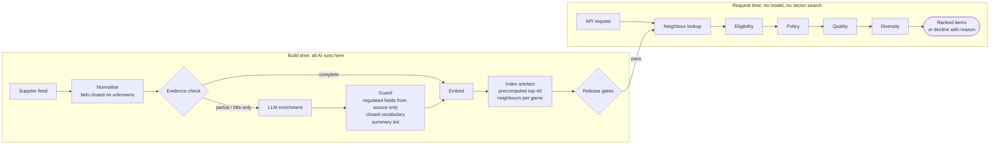

# Related-games recommender

A "Because you played X, you might like…" rail for a regulated, real-money casino product. **All AI work runs at build time.** An LLM fills gaps in matching features behind a guard, an embedder computes each game's neighbours, and an evaluation gates what gets published. **The request path has no model in it.** A stateless service loads the precomputed artefact and walks each seed's neighbours through deterministic, fail-closed rules: eligibility, safer-gambling policy and relatedness. When too little survives, it declines and the page hides the rail. Similarity proposes; rules dispose.

> **Status** (committed OpenAI build, index `ef13f1ecf784`, [`eval/reports/latest.md`](eval/reports/latest.md)): **not releasable.** 14 of 15 release gates pass; `ndcgLiftOverRawText` fails (−0.003).
>
> - **The service declines 117 of 184 ranking queries** (28 `INSUFFICIENT_SOURCE_DATA`, 89 `NO_CONFIDENT_MATCHES`) and answers 67. A declined rail is hidden.
> - **liberty/NJ returns no rails at all:** 0 of its 25 queries are answered. Only 22 live, eligible games serve NJ, across 13 themes, and 10 of those themes have fewer than 3 games. So no NJ seed finds the three theme-or-series mates a rail needs (`quality:no_shared_theme`, `minResults` 3). `npm run demo` shows this as case 3's expected decline.

## Trade-offs and limitations

Every figure here is from `eval/reports/latest.json`, the committed OpenAI build (index `ef13f1ecf784`), unless marked *offline*.

- **Precision over coverage.** The service answers 67 of 184 ranking queries and declines the rest. All-query coverage is 0.396, over the 169 queries that shouldn't abstain. This is deliberate: on a regulated lobby, a decline the lobby can fall back on beats an unrelated rail under "Because you played X".
- **Why coverage is structurally low here.** There are 108 games across 5 markets and 4 brands (`config/service.json`) and many themes. Many themes have fewer than 3 eligible games: 8 of 17 on aurora/GB, 11 of 21 on harbour/GB and 10 of 13 on liberty/NJ. So the relatedness rule often has nothing to offer. A larger catalogue would be expected to raise coverage, because more themes would have three eligible members. That's an expectation from this mechanism, not a measured result.
- **liberty/NJ returns no rails**, the clearest example: 22 live eligible NJ games across 13 themes. Even the oracle answers none of its 25 queries.
- **Quality when it does answer:**
  - nDCG@5 is 0.725 (gate ≥ 0.6);
  - the bad-rec rate is 0.137 (gate ≤ 0.15);
  - gated coverage is 1.0 (gate ≥ 0.8). That 1.0 is flattering, because the gated oracle obeys the same theme rule, so a decline the rule causes never counts as a false abstention. Against an oracle without the rule, coverage is **0.843** over 70 answerable queries.
- **Lift over raw text is −0.003** (0.725 against 0.728): on this catalogue, enrichment is ranking-neutral at noise level. Its measured value is elsewhere:
  - fill rates, from source to output: game type 0.736 → 0.891, themes 0.655 → 0.827, mechanics 0.582 → 0.727, volatility 0.618 → 0.636, with 0 protected-field violations;
  - forcing thin records to decline: an expected-decline rate of 1 on the 15 title-only and opaque seeds.
- **Where it gets it wrong:**
  - **The four lowest-nDCG seeds.** g-019 "Fruit Blast Scratch", g-061 "Fishing Frenzy Pick Bonus" and g-090 "Catch of the Day Scratch" each score nDCG@5 0, because they are served theme-mates of another game type (a scratch card or bingo game gets fruit or fishing slots). g-008 "Secrets of the Sphinx" scores 0.184, with a scratch card at #3.
  - **g-050 "Roulette Royale"** declines on aurora/GB, although ground truth has 4 related eligible tables. It's this build's one trap miss (39/40). The rule needs a shared theme, but the labels relate same-type tables whatever their theme.
  - **g-003 "Crypt Legends"** (*offline*, `eval/reports/offline/latest.json`): a cold-start decline, the offline build's one miss (38/39 traps). The offline build is a software check, not the shipped system.
  - **Two misleading-title rows prove nothing.** g-019 and g-057 pass vacuously: both titles name their true type ("Scratch"), so they don't test whether enrichment trusts the copy over a misleading title.

## How it works

Models run once, when the index is built; each request only reads that index and applies rules.



The ADR's [diagram](docs/ADR-001-recommender-architecture.md#3-diagram) is the full version, with the AWS mapping. [Failure behaviour](docs/ADR-001-recommender-architecture.md#7-failure-behaviour) is in the ADR too.

## The four layers

Every candidate passes every layer, in order, on every request. No similarity score can outweigh a layer. Rule values are from [`config/service.json`](config/service.json); results are from the committed OpenAI build (index `ef13f1ecf784`, [`eval/reports/latest.md`](eval/reports/latest.md)).

| Layer | Question | Rules | Result on the OpenAI build |
| --- | --- | --- | --- |
| 1. Information integrity | Can we trust what enrichment says? | The guard keeps a closed vocabulary, lets source values win, and lints summaries; protected fields come only from normalisation; title-only and opaque records are flagged insufficient | 0 protected-field violations, 0 regulated fields invented, 0 injection leaks; game-type accuracy 1 (gate ≥ 0.9), theme precision 0.85 (gate ≥ 0.7) |
| 2. Hard eligibility | May this game be shown to this player? | It must be live, not a test build, on the brand, licensed in the market and in season, with no restricted feature (`bonus_buy` in GB). Every check fails closed | 0 violations in 2,260 calls checked against ground truth |
| 3. Recommendation policy | Should we nudge this player to it? | At most 1 volatility step up, max bet ≤ 5× and min bet ≤ 10× the seed's; unknown volatility or stakes fail closed | 0 violations in 2,260 calls |
| 4. Abstention | Do we know enough to recommend anything? | A shared theme or series; at most 3 per studio and 2 per series; score threshold 0.45; fewer than 3 survivors → decline | Expected-decline rate 1 (gate ≥ 0.8); coverage 1 (gate ≥ 0.8), 0.843 against the rule-free oracle |
| Ranking | Are the games shown related? | (measured, not enforced) | nDCG@5 0.725 (gate ≥ 0.6); bad-rec 0.137 (gate ≤ 0.15); lift over raw text −0.003 (gate ≥ 0, **fails**) |

## Read this

| Document | What it's for |
| --- | --- |
| [`docs/ADR-001-recommender-architecture.md`](docs/ADR-001-recommender-architecture.md) | The architecture decision: what runs where, AWS choices, alternatives, what a player sees when anything fails, scaling triggers, revisit criteria |
| [`docs/EVALUATION.md`](docs/EVALUATION.md) | How AI quality is judged: metrics, gates, planted traps, failure analysis, known limitations |
| [`eval/reports/latest.md`](eval/reports/latest.md) | The latest report on the committed OpenAI build (with `latest.json`) |
| [`docs/LEVERAGE.md`](docs/LEVERAGE.md) | Part B: the reusable skill and how it applies to the next prototype |
| [`docs/AI_USAGE.md`](docs/AI_USAGE.md) | The AI tools used, and every agentic artifact in the repo |
| [`docs/prompts/`](docs/prompts/) | The specs the repo was built from, in order, with their decisions |
| [`AGENTS.md`](AGENTS.md) | The working rules for any agent or person changing this repo |
| [`START_HERE.md`](START_HERE.md), [`docs/plan.md`](docs/plan.md), [`REBUILD_NOTES.md`](REBUILD_NOTES.md) | The record of how the repo was built: the build loop, the milestone checklist, and every choice where a spec was silent |

## Run it (no API key needed)

```bash
npm ci                                       # Node 20+
npm run typecheck && npm test
npm run demo                                 # every path through the service, on the committed OpenAI build
npm run eval                                 # the evaluation report for the committed OpenAI build

npm run generate -- --provider=offline       # keyless stand-in dataset → data/offline/
npm run build:index -- --provider=offline    # rules enricher + hashing embedder → artifacts/offline/
npm run demo -- --provider=offline
npm run eval -- --provider=offline           # → eval/reports/offline/
npm start                                    # serves artifacts/index.json on 127.0.0.1:3000
```

### CI: two workflows, two questions

| Workflow | Runs | Answers | Today |
| --- | --- | --- | --- |
| [`check`](.github/workflows/check.yml) | `npm ci`, typecheck, tests, demo | Does the code work? | Expected green |
| [`release-gate`](.github/workflows/release-gate.yml) | `npm ci`, `eval:gate` on the committed OpenAI build | Is this build fit to ship? | **Red, as intended:** `ndcgLiftOverRawText` −0.003 (gate ≥ 0) |

They're separate because software tests and AI evaluation answer different questions, so they report separately. A test pass says nothing about AI quality, and a gate failure says nothing about the code. **A red release gate is the system working as designed:** the code works, the build misses the release bar, and the release is blocked pending review. Neither workflow uses `continue-on-error`. The way to green is a better build or a reviewed gate change, never a tuned gate. Both need no API key, because they read committed artefacts.

Offline builds go to the git-ignored `data/offline/`, `artifacts/offline/` and `eval/reports/offline/`. They're a software check, not the shipped system. `demo` and `eval` read the committed OpenAI build unless given `--provider=offline`, and they never fall back from one build to the other. To serve an offline index, set `INDEX_PATH=artifacts/offline/index.json`. On a `.env` with a key, always pass `--provider=offline` to `generate` and `build:index`.

### The API

| Route | What |
| --- | --- |
| `GET /v1/games/:gameId/related?brand=&market=&limit=` | The rail. `brand` and `market` are required (`market` is one of GB, ES, SE, NL, NJ). `limit` is optional: default 6, clamped to 12. The header `x-player-restricted: true` marks a restricted player |
| `GET /health` | Liveness: always 200 |
| `GET /ready` | 200 once a valid index is loaded, otherwise 503 |
| `GET /metrics` | Prometheus text: request counter (outcome, reason, brand), latency histogram, `recs_index_info` |

**The response shape** is the same for answers and declines: `{ gameId, seedTitle, brand, market, indexVersion, status: "ok" | "declined", reason?, items: [{ gameId, title, score }] }`. It carries `x-index-version`, `vary: x-player-restricted`, and `public, max-age=300`, or `private, no-store` for a restricted player.

**Status codes and declines.** A decline is a 200 with an empty `items` list; the page hides the rail.
- **Decline reasons:** `BRAND_DISABLED`, `PLAYER_RESTRICTED`, `SEED_NOT_AVAILABLE`, `INSUFFICIENT_SOURCE_DATA`, `NO_CONFIDENT_MATCHES`, plus `MARKET_NOT_SERVED_BY_BRAND` inside `recommend()`.
- **404** for `UNKNOWN_GAME`, with the same body shape.
- **400** `{ status: "error", error }` for `invalid_request`, `unknown_brand` and `brand_not_offered_in_market`.
- **503** `{ status: "unavailable", items: [] }` with no index loaded.

Example (`npm run demo`, case 3, OpenAI build):

```http
GET /v1/games/g-001/related?brand=liberty&market=NJ

200  cache-control: public, max-age=300
{"gameId":"g-001","seedTitle":"Orchard Classics: Berry Burst Spins","brand":"liberty","market":"NJ",
 "indexVersion":"ef13f1ecf784","status":"declined","reason":"NO_CONFIDENT_MATCHES","items":[]}
```

## Rebuild with a model

```bash
cp .env.example .env                          # add OPENAI_API_KEY
npm run generate -- --provider=openai         # → data/generated/
npm run build:index -- --provider=openai      # → artifacts/ (the enrichment cache in .cache/ is committed)
npm run eval:gate                             # exit 1 if any release gate fails
```

Commit `data/generated/`, `artifacts/` and `eval/reports/` so CI can demo and gate the build. **Only `text-embedding-3-small` has a score threshold** (`config/service.json`). The service refuses an index built with any other embedding model until that model gets its own threshold from the sweep (spec 05 §6.3). Tune the threshold from the report's sweep; never tune a gate.

## Dataset design

The catalogue is synthetic and fictional, built to look like a real supplier/CMS feed: uneven, inconsistent, partly missing and occasionally hostile ([spec 01](docs/prompts/01-dataset-spec.md)). **108 canonical games are represented by 113 feed records.** The 5 extra records are 3 duplicate exports and 2 RTP variants of existing games, which ingestion must recognise as the same game. Of the 108 games, 100 come from a seeded slate and 8 are guardrail traps derived from real games ([spec 02](docs/prompts/02-guardrail-layers-and-compliance-traps.md)).

A record is several things at once: a partial-quality NJ slot in a series can also be a planted trap. So every record in `eval-reference.json` is labelled on independent dimensions rather than one cohort, and `manifest.json → evaluation_dimensions` counts each against its own denominator.

| Dimension | Denominator | Values |
| --- | --- | --- |
| `gameType` | 108 canonical games | `slot`, `table`, `live`, `instant_win`, `bingo` |
| `volatilityBand` | 108 canonical games | `low`, `medium`, `high`, `extreme` |
| `series` | 108 canonical games | a series id, or none |
| `semanticCluster`, `clusterRole` | 108 canonical games | one of the 4 benchmark clusters below, as `member` or `near_miss`; or none |
| `marketProfile` | 108 canonical games | `eu_only`, `eu_and_nj`, `nj_only`, `none` |
| `brandScope` | 108 canonical games | `single_brand`, `multi_brand` |
| `distribution` | 108 canonical games | `direct`, `aggregated` |
| `qualityProfile` | 113 feed records | `rich`, `partial`, `thin`, `title_only` |
| `trapTypes` | 113 feed records | every planted edge case or trap on the record, e.g. `prompt_injection`, `duplicate_export`, `market_twin`, `escalation_twin`, `test_game`, `seasonal`, `cryptic` |

**Benchmark clusters** ([spec 03](docs/prompts/03-benchmark-clusters-and-evaluation-dimensions.md)). Four designed clusters sit inside an otherwise organic, seeded-random catalogue. Each has 5 members that should recommend each other, and 2 near-misses that share the theme but differ in game type or mechanics, so they should rank below the members.

| Cluster | Members (5) | Near-misses (2) |
| --- | --- | --- |
| `egyptian_cascade` | Egyptian slots; cascading reels, multipliers; high volatility | an Egyptian scratch card (low); an Egyptian classic fixed-payline slot (low) |
| `fishing_cash_collect` | fishing slots, also underwater; cash collect, free spins; medium/high volatility | a fishing scratch card (low); a fishing bingo game with a pick bonus (low) |
| `classic_fruit` | classic fruit slots; fixed paylines; low volatility | a fruit Megaways slot with cascading reels (high); a fruit Megaways slot with bonus buy (extreme) |
| `live_game_show` | live game shows; bonus wheel, multipliers, live dealer; medium volatility | a live roulette game (low); a live card game with side bets (low) |

Cluster members are on every European brand and market, with the same stakes and five different studios, so recall depends on similarity alone, not on licensing, the stake policy or the studio cap.

Per-cluster reporting matters because one overall score can look fine while one kind of game is badly served, and near-misses show whether matching understands more than the theme word.

## How the pieces fit

```
BUILD TIME (scripts/, src/pipeline/, src/ai/)                     REQUEST TIME (src/service/)

catalogue.raw.json ──► normalise.ts ──► evidence check                GET /v1/games/:id/related
  (messy feed)        (only reader of     │                                   │
                       raw records;       ├─ complete ──────────┐             ▼
                       protected fields)  └─ partial/title-only │      brand / market / restriction
                                              ▼                 │             │
                                    enrich.ts (LLM or rules)    │      seed checks (unknown, not
                                              ▼                 │      available, insufficient)
                                    guard.ts (vocabulary,       │             │
                                    source wins, lint,          │             ▼
                                    provenance)                 │      walk neighbours by score:
                                              ▼                 ▼        layer 2 eligibility
                                    build-index.ts: embed + top-40          layer 3 policy
                                              │                           quality + relatedness
                                              ▼                           diversity caps
                                    eval/ (npm run eval:gate) ─ fail ─► keep current index
                                              │ pass                         │
                                              ▼                              ▼
                                    artifacts/index.json ───────────► ≥ 3 items: ok, else decline
                                    (versioned, Zod-validated on load)  (page hides the rail)
```

## Production concerns: what I built and what I left out

**Built:**
- **The four layers**, every rule failing closed, with a test per decline reason.
- **The guard between the model and everything downstream**, tested against planted injection, fluff and title-only records.
- **The evaluation as a release gate:** 15 gates as data, `eval:gate` exits 1, deterministic and free to run. It also reports per-brand coverage, so a brand with no rails is named.
- **Versioning:** content-addressed enrichment cache, versioned prompts, `indexVersion` derived from the inputs, schema-checked artefacts, atomic writes and checkpointed caches.
- **A keyless offline path** for tests and CI.
- **Operations:** structured logs with no player data, Prometheus metrics, `/health` and `/ready`, CDN-friendly cache headers with a restricted-player bypass, and two CI workflows (`check` for the code, `release-gate` for the build).

**Left out:**

| Left out | Why |
| --- | --- |
| Auth and rate limiting | Belong at the edge (CloudFront/WAF, API gateway), not in the service |
| Hot reload of the index | A new index ships as new tasks behind `/ready`; a rolling deploy is simpler and safer than swapping in place |
| A vector DB | The query is always a known game, so neighbours are precomputed; at this size the artefact fits in memory (ADR §5) |
| A live eligibility overlay | The main known gap, named in ADR §6. Eligibility is snapshotted with the index; the overlay is the next step |
| Age and identity checks | The lobby's job before any game page; the service trusts only the restricted-player flag it's given |
| A "trending" fallback rail | It would pad a declined rail with unrelated games, against "decline over pad" (AGENTS.md rule 7) |
| Personalisation and A/B testing | Need player data and an experiment platform. The A/B test, with safer-gambling guardrails, is the next evaluation step (EVALUATION.md) |
| A review UI for enrichment | Nothing generated is shown to players, so there's nothing to approve before publish; the report's wrong-fills sample serves reviewers for now |
| Infrastructure as code | The brief asks for the infrastructure to be described (ADR §4), not built |
| A generated spec appendix with a drift check | The excerpts are fragments of files, so generating them needs markers in production code or brittle parsing. The appendix is maintained by hand, and the identity hash already checks the dataset (spec 07 Decisions) |

## Repository map

| Path | What |
| --- | --- |
| `src/domain/` | Vocabulary, types, the index schema |
| `src/catalogue/` | Synthetic dataset generation: slate, creative, traps, degradation, repairs, the real-name deny-list |
| `src/pipeline/` | `normalise.ts`, `enrich.ts`, `guard.ts`, `build-index.ts` |
| `src/ai/` | Model providers: OpenAI chat and embeddings, the hashing embedder |
| `src/service/` | `recommender.ts` (the rules), `server.ts`, `index-store.ts`, `metrics.ts`, `service-config.ts` |
| `scripts/` | CLI entry points: `generate-catalogue.ts`, `build-index.ts`, `demo.ts` (and `demo-cases.ts`) |
| `eval/` | The evaluation: relevance labels, metrics, gates, report; `release-gates.json`; `reports/` |
| `tests/` | Software tests (behaviour, boundaries, docs consistency) |
| `prompts/` | Versioned runtime prompts |
| `config/service.json` | Brands, markets, restricted features, policy numbers, thresholds |
| `docs/` | ADR, evaluation, AI usage, leverage; `prompts/` (specs); `notes/` (inspection and analysis notes) |
| `data/generated/`, `artifacts/`, `eval/reports/` | The committed OpenAI build |
| `data/offline/`, `artifacts/offline/`, `eval/reports/offline/` | Offline builds (git-ignored) |

## Notes from the candidate

1. **Time allocation.** About 4h50m of active build time across two sessions. The split is the interesting part: planning and resolving spec ambiguities took longer than implementing specs 01–03, and the single largest block was the evaluation and the analysis that followed it, not building the service. That matches where the risk actually sat — writing a service from a settled spec is mechanical; deciding what "good" means, and what to do when the gates say no, isn't. Full breakdown in [`docs/AI_USAGE.md`](docs/AI_USAGE.md#time-spent).

2. **AI tools used.** Claude Code (Opus) implemented each spec with its tests; a separate Claude chat session reviewed the design and the evaluation results; a third, fresh session audited the finished repository against this brief. The separation was deliberate — an agent reviewing its own output agrees with itself, and the fresh audit found a broken demo command and two stale figures the building session had missed. Inside the product, `gpt-4o-mini` generates the catalogue and enriches thin records, and `text-embedding-3-small` produces the embeddings; both run at build time only, and I ran every paid step by hand rather than letting the agent spend. Details in [`docs/AI_USAGE.md`](docs/AI_USAGE.md#tools).

3. **One output I changed or rejected.** I refused most of the generator fixes the agent proposed. Reading one of them properly changed my mind about the rest: stripping `live_dealer` from non-live games left four table games whose copy still said "live dealer" and two games with no mechanics at all, so a fix by deletion had manufactured a worse contradiction than the one it removed. More importantly, I was tidying the input. The brief asks for a catalogue that looks like it came from a real system, and a table game described as live dealer is exactly the mess the pipeline exists to cope with. The rule became: fix what breaks a hard requirement or corrupts the evaluation, document everything else. Two fixes survived it — real-world brand names, and duplicate titles inside a benchmark cluster, because titles feed the embedding text and so corrupt the thing the cluster measures. Separately, I rejected a score threshold of 0.69 that passed every gate only by landing exactly on a boundary, and shipped a relatedness rule instead. Full account in [`docs/AI_USAGE.md`](docs/AI_USAGE.md#what-wasnt-kept).

4. **CI status:** `check` is green. `release-gate` is **red by design** — `ndcgLiftOverRawText` is −0.003 against a gate of ≥ 0. Enrichment is ranking-neutral on this catalogue, so by the release criteria this build does not ship on ranking grounds. The gate was not relaxed to make it pass. See `docs/EVALUATION.md`.
   
5. **Result:** Enrichment doesn’t improve ranking on this build, and slightly hurts the clusters. Recall@5 drops 0.95 → 0.90 and near-miss intrusion rises 0.25 → 0.40. The rules-only enricher ranks level with the LLM. My hypothesis is that the enriched text pulls theme-mates of different game types closer together. The next experiment would be embedding the structured fields only, or weighting game type. I deliberately didn’t run it within the timebox: the gate did its job by blocking the release, and tuning until it passes would be fitting to one run. Enrichment’s measured value today is fill rates (game type 0.74 → 0.89, themes 0.66 → 0.83) and forcing thin records to decline, not ranking.
