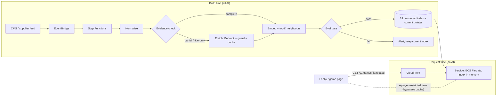

# ADR-001: Precompute related games offline, serve them from a lookup service

- **Status:** Proposed (first production step)
- **Date:** 2026-11-16
- **Numbers:** rule values come from [`config/service.json`](../config/service.json). Results come from the committed OpenAI build (index `ef13f1ecf784`, `gpt-4o-mini` enrichment with `enrich-game.v2`, `text-embedding-3-small`), [`eval/reports/latest.json`](../eval/reports/latest.json).

## 1. Context

**The ask:** a "Because you played X, you might like…" rail on the game page of a regulated, real-money casino product.
- It serves several brands (aurora, harbour and liberty enabled; meridian configured and disabled) and five markets (GB, ES, SE, NL on the European brands; NJ on liberty).
- It sits on a page with a tight latency budget, so the rail must never slow the page.
- The catalogue changes whenever a supplier or the CMS changes a record, and the feed is messy: duplicates, RTP variants, missing fields, contradictory copy and occasionally hostile text.

**Three facts drive the design:**
1. **The output is item-to-item.** A seed's related games don't depend on the player, only on the seed, brand, market and month. So they can be precomputed and cached.
2. **AI steps are slow, costly and non-deterministic.** LLM enrichment takes seconds per record and costs money per call. Even embeddings vary slightly between calls: rebuilding the index from identical inputs moved its version (`docs/EVALUATION.md`, Known limitations).
3. **The surface is regulated.** Showing a game that isn't licensed, live or permitted for this player is a compliance incident, not a ranking error. Generated text shown to players would be an unnecessary risk, because nobody reviews it.

## 2. Decision

**All AI runs at build time; the request path has none.** The service loads a precomputed, validated artefact and applies deterministic rules.

**Build time**, on a catalogue event:
1. **Normalise** the raw feed (`normalise.ts`). This is the only reader of raw records, and the only writer of the protected fields: title, provider, RTP, stakes, max win, layout, jackpot network, brands, markets, status and season.
2. **Run the evidence check** (spec 04 §4):
   - complete records skip the LLM (`skipped_complete`);
   - partial and title-only records go to it;
   - title-only results are stored as low-trust and flagged `insufficient`, so they never seed or fill a rail.
3. **Guarded enrichment.** The model proposes matching features only (game type, themes, mechanics, volatility, a matching summary). The guard (`guard.ts`) does the rest:
   - a closed vocabulary, and source values win;
   - a lint discards any summary with banned or numeric claims;
   - per-field provenance, and a per-record rules fallback.

   Proposals are cached by content hash, model, prompt version and pipeline version.
4. **Embed and precompute neighbours:** exact cosine similarity, top 40 per game.
5. **The evaluation is the release gate.** `npm run eval:gate` checks 15 gates across the four layers and ranking. Only a passing artefact is published, versioned and immutable.

**Request time.** A stateless service walks the seed's neighbours in score order through the four layers (spec 02 §2). Each layer runs on every candidate and none can be outweighed by a score:

| Layer | Rule (values from `config/service.json`) |
| --- | --- |
| 1. Information integrity | Matching uses guarded, enriched fields only; a seed flagged insufficient declines |
| 2. Hard eligibility | The candidate must be live, not a test build, on the brand, licensed in the market and in season, with no feature restricted in the market (`bonus_buy` in GB). Every check fails closed: a missing market, status or brand means "not available" |
| 3. Recommendation policy | **At most one volatility step up** from the seed. A **max bet at most 5×** the seed's, and a **minimum bet at most 10×** the seed's. **Unknown volatility or stakes fail closed:** an unknown seed counts as the most cautious player (low volatility, £2 max, £0.10 min), and an unknown candidate is blocked |
| 4. Abstention | Skip duplicates, same-title games, and candidates that share no theme or series with the seed (`quality:no_shared_theme`). Apply at most 3 per studio and 2 per series. Stop below the embedder's score threshold (0.45 for `text-embedding-3-small`). **Fewer than 3 survivors → decline** |

"Similarity proposes; rules dispose." Players see source titles only, never generated text.

## 3. Diagram

## 4. Infrastructure (AWS)

| Concern | Choice |
| --- | --- |
| Trigger | EventBridge on catalogue changes, plus a nightly full rebuild |
| Orchestration | Step Functions, stages as Lambdas (Fargate tasks when large) |
| Models | Bedrock in production (data stays in account and region); OpenAI in the exercise, behind an interface (`src/ai/providers.ts`) |
| Artefact | Versioned, immutable S3 objects; `current.json` pointer is the only mutable object (one-write promote and rollback) |
| Serving | ECS Fargate, ≥ 2 tasks across AZs behind an ALB; CloudFront for unrestricted responses |
| Config | Kill switches and thresholds in AppConfig (a JSON file here: `config/service.json`) |
| Observability | Structured logs and CloudWatch metrics (outcome, decline reason, latency, index version), plus pipeline metrics. Logs carry no player data (spec 07 §3.5) |

## 5. Alternatives considered

| Alternative | Why not (for now) |
| --- | --- |
| Per-request embedding search (e.g. OpenSearch k-NN) | An extra network hop and a stateful cluster to run, when the query is always a known game whose neighbours can be computed in advance |
| LLM in the request path | Latency, non-determinism, can't be cached, and generated text on a regulated page (AGENTS.md rules 1 and 4) |
| Static JSON on S3/CloudFront with no service | Credible. But the safer-gambling flag, the kill switch and threshold tuning would need a rebuild or client logic. **This is the fallback if the team can't own a service** |
| API Gateway + Lambda | A close call. Fargate wins on steady p99 and on loading the artefact once per task rather than per cold start |
| A vector DB as the store of record | Operates a database for a read-only artefact that fits in memory; neighbours are computed once per build |
| A fine-tuned or classical model instead of the LLM | Not ruled out: the `rules_enriched` baseline exists to make that call. On this build it ranks level with the LLM (nDCG@5 0.73 against 0.725), so the evidence for the LLM is fill rates, not ranking |

## 6. Trade-offs we accept

- **Freshness lag.** A catalogue change reaches players only after a rebuild passes the gates.
- **Eligibility is snapshotted with the index. This is the main known gap.** A game withdrawn or relicensed after the build is still judged on the build's view until the next build.
  - Mitigation now: a priority rebuild on status and licence events.
  - Next step: a live eligibility overlay, a small status/licence table read at request time and applied as one more fail-closed check.
- **Thresholds are tied to the embedder.** Only `text-embedding-3-small` (0.45) and the offline `hashing-v1` (0.3) have one; a new embedder needs its own sweep before it can serve.
- **Silver labels.** The ranking gates are measured against a rule over the clean catalogue, not human judgement. A curator golden set is needed before launch.
- **Exact O(n²) neighbours.** Trivial at 113 records; replaced by approximate search at scale (section 8).
- **Low coverage, by choice** (OpenAI build): the service declines 117 of 184 ranking queries and answers 67 (all-query coverage 0.396). A hidden rail beats an unrelated one on a regulated page.

## 7. Failure behaviour: what a player sees

**In every failure case the player sees the page without the rail.** The service never shows an error, a spinner or a fallback list in its place.

| Failure | System behaviour | Player sees |
| --- | --- | --- |
| Service slow or down | The client times out (e.g. at 30 ms) and renders the page without the rail | The page without the rail |
| Brand switched off | `BRAND_DISABLED` decline (kill switch in config) | The page without the rail |
| Market the brand doesn't serve | HTTP 400 `brand_not_offered_in_market`, before any lookup; `recommend()` itself would return `MARKET_NOT_SERVED_BY_BRAND` | The page without the rail |
| Malformed request (missing or unknown market, unknown brand, bad limit) | HTTP 400 `invalid_request` or `unknown_brand` | The page without the rail |
| Restricted player (`x-player-restricted: true`) | `PLAYER_RESTRICTED` decline, checked before the seed; `private, no-store`, so it's never cached | The page without the rail |
| Unknown game id | HTTP 404 `UNKNOWN_GAME`, same body shape | The page without the rail |
| Seed not licensed in the market, or a test build | `SEED_NOT_AVAILABLE`, no rail (spec 07 §3.6) | The page without the rail |
| Seed withdrawn or out of season | **Not declined, on purpose** (spec 02 §6.2, spec 07 §3.6): alternatives still shown, every one eligible | A rail of live, eligible alternatives |
| Seed with too little source data (title-only or opaque) | `INSUFFICIENT_SOURCE_DATA` | The page without the rail |
| Fewer than 3 related, eligible games survive | `NO_CONFIDENT_MATCHES`: decline over pad | The page without the rail |
| The most similar game is ineligible | Filtered by layer 2 or 3; the next candidate is considered | A rail without that game |
| A whole brand or market with no rail (liberty/NJ on this build: 0 of 25 queries answered) | Every NJ seed declines `NO_CONFIDENT_MATCHES` or `INSUFFICIENT_SOURCE_DATA`; named in the report's per-brand coverage table | The page without the rail, for every NJ player |
| Bad index at start-up | `loadIndex` refuses it without throwing; `/ready` 503 and the API 503 (`no-store`); old tasks keep serving | Old tasks: the rail as before. New tasks: no traffic until ready |
| LLM outage during a build | Per-record rules fallback, recorded; the gates decide whether the build ships | Nothing changes until a build passes |
| Embedding outage, or a failed gate | Nothing is published; alert; the current index keeps serving | The rail as before |
| A bad index published anyway | Roll the `current.json` pointer back to the last good version (one write) | The rail as before, after rollback |

## 8. Scaling

The service is stateless and CPU-only, holding the artefact in memory, and the CDN absorbs most traffic: unrestricted responses aren't personalised, so they're cacheable (`public, max-age=300`).

| Trigger | Action |
| --- | --- |
| p99 > 10 ms or CPU > 60% | Add tasks |
| CDN hit rate < 90% | Review cache keys and TTL |
| > ~20k games or build > 15 min | Approximate nearest neighbours at build time; shard by brand |
| Artefact ~hundreds of MB | Neighbours to DynamoDB or ElastiCache |
| Enrichment cost or time grows | Batch inference API (the cache and evidence check already limit work) |
| Many brands with different rules | Per-brand eval slices (the report's per-brand coverage table is the first) |

## 9. Evidence that would make us revisit

| Evidence | Alternative it leads to |
| --- | --- |
| An A/B test shows the rail doesn't beat "popular in the same category" (with safer-gambling guardrails) | Replace the rail with the simpler category rail, or drop it |
| The LLM doesn't beat the rules enricher (on this build they rank level: `rules_enriched` nDCG@5 0.73, `enriched` 0.725) | Drop the LLM step for the rules enricher, or a fine-tuned or classical model |
| A golden set disagrees with the silver labels | Re-derive the labels and gates, and revisit `quality:no_shared_theme`, which the silver labels partly encode |
| Compliance needs live eligibility | Add the eligibility overlay (section 6), or per-request eligibility from a live store |
| Product wants personalisation | A per-player re-ranking layer at request time, which changes caching and the ADR |
| Build lag becomes visible | Incremental builds per changed record, and a priority lane for status and licence events |
| **A brand or market whose rails all decline.** The report's per-brand coverage table names it. liberty/NJ is this case on the committed build: 0 of 25 queries answered, with 22 live eligible games across 13 themes, 10 of which have fewer than 3 games | Revisit the relatedness rule (`quality:no_shared_theme`) or `minResults` for that slice, after checking whether catalogue breadth is the cause. Widening the rule brings back unrelated filler, so first prefer more eligible games per theme |
